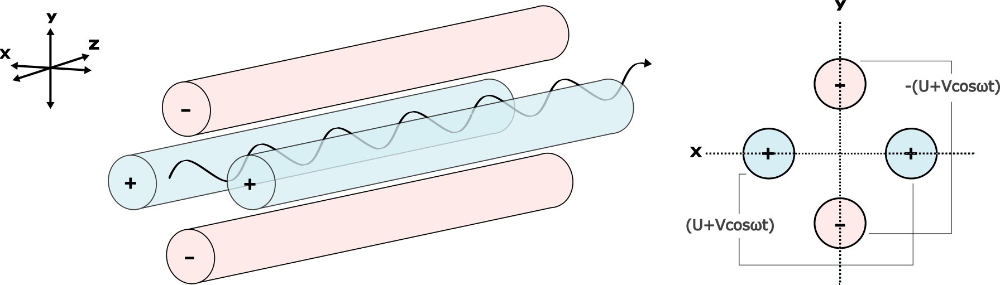
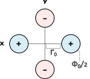

# Mass analyzer design {#sec-analyzer-design}

What's the difference between an analyzer and a filter? We don't know.

Short description of advantages and disadvantages of each type.

## Magnetic sectors {#sec-analyzer-magnetic-sector}

Quick recap of why we need magnets and the dispersion equation. Lorentz force.

### History of magnetic sector geometries {#sec-analyzer-magnetic-sector-geometry}

Dempster, sector field, extended geometry. Focal planes.

### Extended geometry magnetic sector in practice {#sec-analyzer-extended-geometry}

Dispersion, focal plane geometry.

## Electrostatic Analyzers (ESA) {#sec-analyzer-electrostatic}

Why use an ESA instead of a magnet? Before or after magnet? Why is it so often seen on ICPs and less often (or even not at all!) on a TIMS. Reference Coulomb force, a figure of an ion traversing a ESA. 

Advantage is that you can change a voltage quickly (nanoseconds), for instance to deflect a beam.

## Quadrupole Mass Analyzers {#sec-analyzer-quadrupoles}

### Background
Using a combination of static and alternating voltages, quadrupole mass analyzers generate electric fields, rather than magnetic fields, that filter ions based on their mass to charge ratio (m/z). The possibility of using a quadrupole electric field for mass filtering was first proposed in the 1950's by Wolfgang Paul and Helmut Steinwedel, who drew from earlier use of quadrupole magnetic fields for high energy accelerators [@Dawson_1976]. In contrast to sector instruments, quadrupole mass analyzers are considered “dynamic” – to produce a mass spectrum, the strength and/or frequency of their electric fields must be incrementally adjusted throughout the duration of a scan. 

### Mass filtering - how does it work? {#sec-quadrupole-mass-filtering}

Quadrupole mass filters consist of four parallel rods, connected in crosswise pairs. A potential of (U+Vcosωt) is applied to one pair, while a potential of -(U+Vcosωt) is applied to the second pair. Here, Vcosωt represents an alternating RF voltage with an amplitude of V and angular frequency of ω; U represents a static voltage ("DC offset"). More simply, you could express the potentials as (DC+RF), and -(DC+RF).

Though the voltage applied to each pair of rods oscillates continuously, the DC component can be thought of as the *average* voltage applied to each pair. In general, high m/z ions respond to the average voltage – positive DC voltage repels and thus stabilizes them, negative DC voltage attracts and destabilizes them – while lighter ions are more sensitive to the RF component.

::: {.callout-note collapse=true}

## RF Voltage with DC Offset? 

The plots below illustrate how a DC component, or U term, shifts the RF potential and changes its symmetry. A positive DC component shifts the signal upward, both increasing the average voltage and extending its time in the positive region; a negative DC component skews it downward, extending the length of time that the signal is negative.  
```{python}
#| label: quad-potentials
#| fig-cap: "Quadrupole Potentials "

import numpy as np
import matplotlib.pyplot as plt

f = 100_000  # 100 kHz
omega = 2 * np.pi * f
period = 1 / f  # = 10 μs

V = 6000.0
U = 1000.0

num_cycles = 2
samples_per_cycle = 1000  
t_max = num_cycles * period
num_points = num_cycles * samples_per_cycle
t = np.linspace(0, t_max, num_points)

phi1 = V * np.cos(omega * t)
phi2 = U + V * np.cos(omega * t)
phi3 = - (U + V * np.cos(omega * t))

fig, axs = plt.subplots(3, 1, figsize=(6, 10), sharex=True)  # plot dimensions
colors = ['blue', 'green', 'red']
functions = [
    (phi1, 'Φ = V·cos(ωt)', 0),
    (phi2, 'Φ = U + V·cos(ωt)', 1000),
    (phi3, 'Φ = –(U + V·cos(ωt))', -1000)
]

ymin, ymax = -8000, 8000

for i, (ax, (y, label, true_mean), color) in enumerate(zip(axs, functions, colors)):
    ax.plot(t * 1e6, y, label=label, color=color)  # time in μs
    ax.axhline(0, color='black', linewidth=2.0)
    ax.axhline(true_mean, color='darkmagenta', linestyle='--', linewidth=2,
               label=f'U = {true_mean} V')
    ax.set_ylabel('Φ (V)')
    ax.set_ylim(ymin, ymax)
    ax.legend(loc='upper right')
    ax.grid(True)

    if i in [1, 2]:
        ax.annotate(
            '',
            xy=(t[50] * 1e6, true_mean),
            xytext=(t[50] * 1e6, 0),
            arrowprops=dict(arrowstyle='->', color='darkmagenta', lw=1)
        )

axs[2].set_xlabel('Time (μs)')

plt.suptitle('RF Potentials and DC Offsets (100 kHz, V = 6000 Volts, U = 1000 Volts)', fontsize=10.5, x = .49, fontweight='bold')
plt.subplots_adjust(hspace=10)  
plt.tight_layout(rect=[0, 0, 1, 0.95])
plt.show()
```
:::

Because the forces acting on ions traveling through the quadrupole are uncoupled in the X, Y, and Z directions, we can think of mass filtering in terms of two separate planes: the XZ-plane, or X-direction, and the YZ-plane, or Y-direction. Note that in the Z-direction (along the length of the quadrupole), the net force acting on ions is zero. 




In the X-direction, ion stability is determined by the two rods with positive DC voltage. In this direction, low m/z ions generally follow the RF component of the field, gain energy, and oscillate with increasing amplitude until they collide with the rods. Meanwhile, high m/z ions are pushed toward the Z-axis and stabilized by the positive DC component. This creates a "high-pass" filter in the X-direction that allows only heavier ions to maintain their trajectory. 

In the Y-direction, ion stability is determined by the rods with negative DC voltage. While the negative DC component has a "de-focusing" or destabilizing effect on large ions, the RF component can keep lighter ions on course by periodically correcting their paths. In this direction, the applied electric fields create a "low-pass" filter through which only lighter ions can maintain their trajectory. 

By manipulating the RF and DC components of the field, the high and low-pass filters can be set to resolve individual atomic masses. The following section discusses the impact of RF and DC voltages on ion stability in more detail.  

### Equations of motion


The equations of motion that describe ion paths within a quadrupole depend on: 


(a) the hyperbolic geometry of the electric field 
(b) the time-dependent potentials (voltages) applied to the rods


Since, in the case of quadrupole mass analyzers, the time-dependent potentials contain a cosine function, the equations that describe ion motion within a quadrupole will be "Mathieu-type" equations. The Mathieu equation is a specific case of the Hill differential equation--a linear, second-order differential equation with a periodic (oscillating) coefficient--whose coefficient is a cosine function.

The canonical form of the Mathieu equation is:
$$\frac{d^2u}{dξ^2} + (a_u - 2q_ucos2ξ)u = 0$$

Importantly, there are two categories of solutions to this equation: bounded solutions, which correspond to stable ion trajectories through the analyzer, and unbounded solutions, which correspond to unstable ion trajectories. 

::: {.callout-warning}
## Parameters a and q
Here a and q are dimensionless parameters that modify *which solutions* to the equation are stable and which are unstable. That is, **different values of a and q will result in different equations, each with a unique set of stable and unstable solutions**. Modifying a and q thus allows you to control which m/z are stable in the analyzer and which are not. 
:::

Below is a loose derivation of the equations of ion motion relating the direct and alternating components of the voltages (U and V) to the parameters a and q. For a step-by-step derivation, check out [Section II](https://books.google.com/books?id=A6o3BQAAQBAJ&lpg=PA9&dq=quadrupole%20mass%20analyzer&lr&pg=PA9&output=embed) in [@Dawson_1976].

Starting with the geometry, we can come up with a general equation for the electric potential throughout the quadrupole, i.e. the equation for potential within a hyperbolic electric field: 

::: {.callout-note collapse=true}
## More detailed steps

Start with a general geometric description of a quadrupole electric field: 

\begin{equation}
E = E_0(\lambda x + \sigma y + \gamma z)
\end{equation}

Choose weighting constants $\lambda$, $\sigma$, and $\gamma$ such that they satisfy the differential form of Gauss’ Law (the Laplace equation, since the charge enclosed in the quadrupole is zero): 
$$
\nabla \cdot E = 0
$$

There are multiple solutions, but we will use: $\lambda = -\sigma$, $\gamma = 0$

Integrate the general equation of the electric field to get the potential and then plug in our values for $\lambda$, $\sigma$, and $\gamma$: 

\begin{equation}
\Phi = -\frac{1}{2}\lambda E_0(x^2 - y^2)
\end{equation}

Now, assume the distance between the rods is $2r_0$ and the potential on each rod is $\frac{\Phi_0}{2}$.



Then, at the interior surface of the two rods in the XZ-plane, $x = r_0$ and $y = 0$, such that:
$$
\frac{\Phi_0}{2} = -\frac{1}{2}E_0 \lambda r_0^2
$$

Solving for $E_0 \lambda$ and plugging back in to the first equation for potential gives: 
$$
\Phi = -\frac{\Phi_0}{2r^2} (x^2 - y^2)
$$
:::
$$
\Phi = -\frac{\Phi_0}{2r^2}(x^2 - y^2)
$$

To derive the equations of motion for ions in the X and Y directions, we relate the potential within the quadrupole to Newton’s second law, $F=ma$.

This can be done by taking gradient of our potential function and making appropriate substitutions, which yield:

::: {.callout-note collapse=true}
## More detailed steps
At any point in an electric field, the electrostatic force on a ion is the product of the electric field at that point and the charge (q) of the ion:
$$F=Eq$$


So, splitting up Newton's second law into X and Y directions, and substituting Eq in for F, we re-write it as follows:
$$E_xq=m\frac{d^2x}{dt^2}$$ $$E_yq=m\frac{d^2y}{dt^2}$$


Acceleration is now denoted as the second derivative of position with respect to time.


Taking partial derivatives of the potential (above) with respect to x and y will give us equation for the Electric field as functions of x and y, which we can plug in for $E_x$ and $E_y$. Substituting e (elementary charge) in for q, we have:


$$ \frac{x\Phi_0}{r_0^2}(e) = m\frac{d^2x}{dt^2}$$


$$ \frac{y\Phi_0}{r_0^2}(e) = m\frac{d^2y}{dt^2}$$


Moving all terms to the left side of the equation, we have:


$$\frac{d^2x}{dt^2} + \frac{e}{mr_0^2}(\Phi_0)x = 0$$


$$\frac{d^2y}{dt^2} + \frac{e}{mr_0^2}(\Phi_0)y = 0$$
:::

$$\frac{d^2x}{dt^2} + \frac{q}{mr_0^2}(\Phi_0)(x) = 0$$

$$\frac{d^2y}{dt^2} + \frac{q}{mr_0^2}(\Phi_0)(y) = 0$$


In each equation, $\Phi_0$ can be replaced with the actual potentials applied to the rods. Note, again, that the applied potentials are periodic functions of *time*:


$$\frac{d^2x}{dt^2} + \frac{e}{mr_0^2}(U+V\cos(ωt))x = 0$$


$$\frac{d^2y}{dt^2} - \frac{e}{mr_0^2}(U+V\cos(ωt))y = 0$$


These are the equations of motion! YAY! A final substitution is needed to put them in the standard form of Mathieu's equation, defining the parameters a and q as follows [@Dawson_1976]:

(Definitions of a and q may differ between sources by a factor of 2, depending on whether U and V have been defined as the full potential or half the potential applied to each pair of rods.)
$$ a = \frac{4eU}{mω^2r_0^2}$$
$$ q = \frac{2eV}{mω^2r_0^2}$$

Substituting in a and q, and defining the parameter $ξ = \frac{ωt}{2}$, yields:
$$\frac{d^2x}{dξ^2} + (a - 2qcos2ξ)x = 0$$
$$\frac{d^2y}{dξ^2} + (a - 2qcos2ξ)y = 0$$

Solving these equations is complicated, and most easily done with a computer. For the purpose of understanding quadrupoles, however, analyzing the impact of the parameters a and q is perhaps more important than knowing actual solutions to the equations. 

Since a and q both contain a factor of $\frac{e}{mω^2r_0^2}$: $$\frac{a}{q} = \frac{2U}{V}$$ Notice that if U and V are multiplied by the same constant (preserving $\frac{U}{V}$), any of the factors m, ω, or $r_0$ can also be multiplied by that constant such that a and q remained unchanged, preserving the stability boundaries of the solutions. 

In practice, these stability boundaries translate to mass resolution. Typically, only U and V are manipulated--the dimensions of the instrument and the frequency of the RF voltage remain constant. The result is that scaling U and V proportionately preserves the resolution of the mass filter but selects for a different range of masses. 

So, if $\frac{U}{V}$ has been tuned to resolve individual atomic masses, then scaling $\frac{U}{V}$ up or down will select for a higher or lower individual atomic mass. Scaling $\frac{U}{V}$ throughout the duration of a scan can thus produce a mass spectrum. If, instead, the ratio of DC to RF voltage is altered, then the mass resolution of the analyzer will change. 

### Stability diagrams
- Introduce stability diagram of U/V (specific to a particular m/z), and demonstrate how a and q can be used to generalize the stability diagram
- Altering U and V but keeping a/q constant → ions of increasing or decreasing m/z traverse the mass filter, creating a mass spectrum
- what happens if a/q is not kept constant? → alters resolution, ie pushes the a/q line either above the peak or too far down to provide unit mass resolution → question: how does this compare to a U/V plot?

### Operation and typical geometry of instrument


### Advantages

Quadrupoles can be used on their own, linked in series (e.g. triple quadrupole), or combined (either as filters or analyzers) with other mass analyzers. Compared to sector instruments, they are reliable, fast, and relatively inexpensive. However, they generally offer lower throughput and resolving power.


## Time of flight mass analyzer (TOF) {#sec-analyzer-TOF}

Some history. Space applications. Nanoparticle and environmental applications.

Geometries: reflection plates or not.

Notch filters. If you have oxygen, you have to notch it because it overwhelms everything else. 

Simultaneous collection of all ionized species regardless of mass.

Disadvantages: Much less sensitive for low-z species. Lower sensitivity than quadrupole, also more expensive. Advantages: really fast, very small (fits on a benchtop), suited for imaging applications, portable applications, and extraterrestrial applications.

## Accelerator Mass Spectrometer (AMS) {#sec-design-AMS}

Large, expensive instruments, very high voltages. Contains several of the mass analyzers mentioned above, plus more components.

## Orbitrap mass analyzer {#sec-design-Orbitrap}

Max can clean this up later. Thanks Max!

## Ion trap mass analyzer {#sec-design-ion-traps}

Stephen can discuss advantages and disadvantages here.